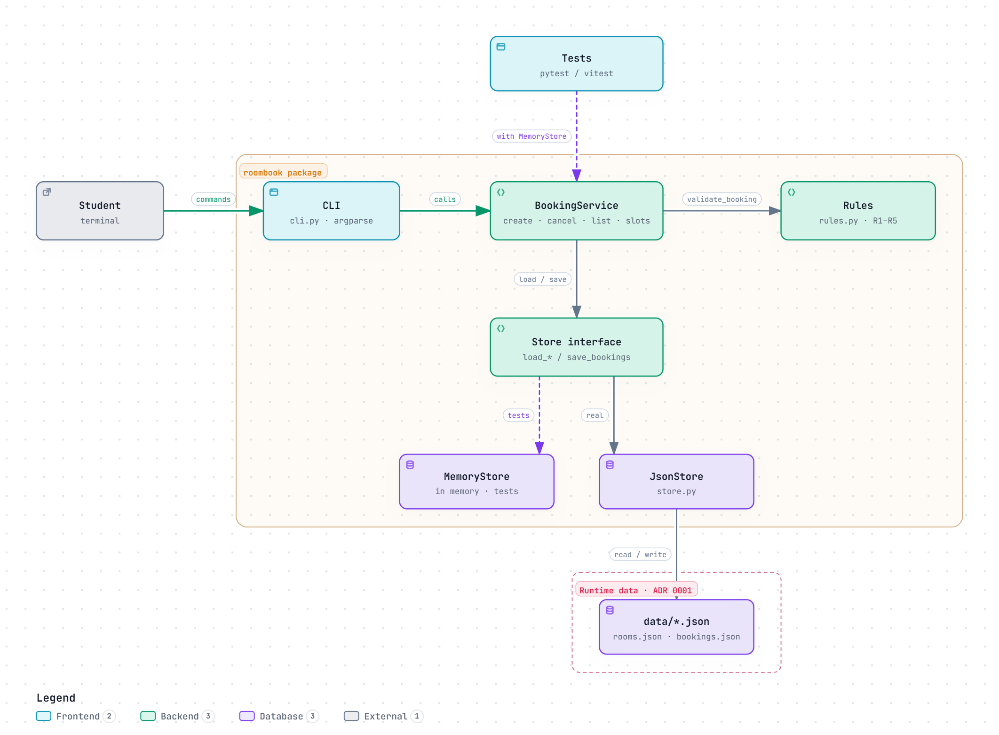

# roombook · Study-room booking at the Kinneret library

The practice repo for the **Software Development with Claude** workshop (Matan Technology Solutions · Matan AI).
Python version. An identical TypeScript version lives in the `roombook-ts` repo.

## Setup
```bash
python3 -m venv .venv
source .venv/bin/activate        # Windows: .venv\Scripts\activate
pip install -e ".[dev]"
```
Requires Python 3.11 or later. No external runtime dependencies.

## Tests and lint
```bash
pytest -q          # all tests
ruff check .       # lint
```

## CLI usage
```bash
roombook rooms
roombook list --room R101 --day 2026-12-06
roombook free --room R101 --day 2026-12-06 --minutes 60
roombook book --room R101 --student 315000111 --start 2026-12-06T12:00 --end 2026-12-06T13:00 --group 3
roombook cancel --id a1b2c3d4
```
Without installing: `python -m roombook.cli rooms` (from the `src` directory).

## Architecture
<picture>
  <source media="(prefers-color-scheme: dark)" srcset="docs/architecture-dark.png">
  
</picture>

The layers of this repo: the CLI only parses and prints, `BookingService` owns the behaviour, the rules are pure functions (testable without files), and storage sits behind a store with a JSON and an in-memory implementation.

## Project map
```
src/roombook/
  models.py    Room, Booking
  rules.py     rules R1–R5: opening_hours, overlaps, validate_booking
  service.py   BookingService: create / cancel / list / free_slots
  store.py     JsonStore (files) and MemoryStore (tests)
  cli.py       command line
data/          rooms.json, bookings.json — never edit by hand
tests/         pytest
docs/specs/    specs. 0000 = booking rules, TEMPLATE.md = template for a new spec
docs/adr/      architecture decisions
docs/issues/   workshop tasks (001–004)
```

## Workshop tasks
| issue | session | topic |
| --- | --- | --- |
| 001 | 2 | bug: back-to-back bookings are rejected |
| 002 | 2 (bonus) | bug: Friday hours |
| 003 | 4 | feature: waitlist (spec + TDD) |
| 004 | 5 | feature: weekly recurring booking (in pairs, PR) |

`CLAUDE.md.example` is a skeleton — in Session 3 you turn it into a real `CLAUDE.md`.
